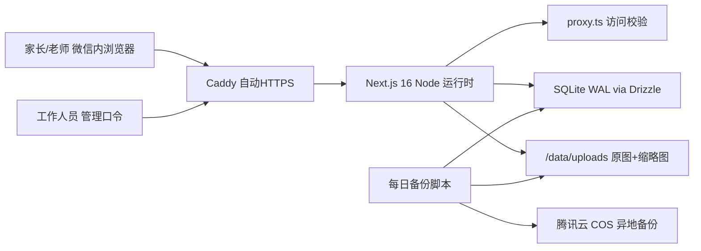

# 伴学星学习档案网站 开发规划

> 2026-11-10 的初版规划，已据此完成第一期，过程中有调整：部署改为重庆服务器（systemd + nginx），并新增了导入群消息、课前计划、老师简历。现状以 [功能说明](./功能说明.md) 和 [项目约定](./项目约定.md) 为准，本文不再更新。

需求来源：[需求文档.md](./需求文档.md)

## 1. 已定的默认决策（可改）

- **部署**：香港轻量云服务器（腾讯云 Lighthouse 香港 2 核 2G，约 30-60 元/月）加一个 .com 域名。不需要 ICP 备案，大陆和微信内都能打开。vercel.app 在微信里经常打不开，所以不用。
- **访问控制**：家长和老师通过私密链接 `https://域名/s/<随机串>` 进入，链接写入一个长期 Cookie。工作人员进 `/admin` 需输入管理口令。
- **上线节奏**：今晚做出核心功能，明天（11/11）上午部署；周三到周日学生上课期间边用边改。
- **前置条件**：今晚需要有人买好服务器和域名，并提供学生称呼、9 个科目和对应老师名单。

## 2. 技术路线

- **框架**：Next.js 16 App Router，React 19，TypeScript strict，`output: "standalone"`。页面以服务端组件为主，前端 JS 少，微信内打开快。写代码前先读 `node_modules/next/dist/docs/` 核对 16 版 API（`proxy.ts` 已替代 middleware）。
- **样式**：Tailwind CSS v4 + CSS 变量 token；弹窗、Tabs、下拉、Toast 用 shadcn/ui（Radix）作底层，全部按我们的 token 重新上样式；图标用 Lucide。
- **数据**：SQLite（better-sqlite3，WAL 模式，开外键约束）+ Drizzle ORM + drizzle-kit 迁移。单个学生、并发很低，SQLite 最稳也最容易备份。表结构预留 `student_id`，以后多学生不用推倒重来。
- **文件**：存服务器磁盘，按 UUID 命名防路径穿越；先写临时文件再原子 rename；用 sha256 去重；用 `file-type` 嗅探真实类型。`sharp` 生成 400px 缩略图和 1600px 预览图（WebP，按 EXIF 自动转正），原图只在下载时传。
- **常用库**：`zod` 校验所有输入；`archiver` 流式打包 ZIP；`react-markdown` + `rehype-sanitize` 渲染老师总结（粘贴微信文本保留换行）；`yet-another-react-lightbox` 做手机看图，支持双指缩放；`date-fns` 中文语言包。容器设 `TZ=Asia/Shanghai`，日期存成本地日期字符串，避免时区错位。
- **部署**：Docker 多阶段构建，docker compose 跑 app 和 Caddy 两个服务，数据卷挂 `/data`，配 `restart: unless-stopped` 和 `/api/health` 健康检查。
- **备份与监控**：每天凌晨用 `sqlite3 .backup` 备份数据库，用 `rclone` 增量同步上传目录到腾讯云 COS，保留 14 天，附带恢复脚本并实际演练一次。另用 UptimeRobot 或 Lighthouse 自带告警监控 `/api/health`。
- **测试**：Vitest 覆盖鉴权、存储、时间工具；Playwright 冒烟测试覆盖 4 条主流程（私密链接进入、上传资料、录入纪要、手机尺寸浏览）。
- **成本**：服务器约 30-60 元/月，域名约 70 元/年，COS 备份约 5 元/月，远低于 500 元/月预算。

## 3. 数据模型

- `subject`：科目名、slug、学科色、排序、老师姓名、老师整体规划（Markdown）及更新时间
- `lesson`：一张表同时承担课表和纪要。字段有科目、日期、开始和结束时间、状态（`planned` / `done` / `cancelled`）、本节内容、下节准备清单、课后作业、腾讯会议录制链接、来源
- `material_set`：资料册（如"数学七上课本 第三章"），字段有科目、类别（课本 / 试卷 / 考试 / 作业 / 笔记 / 其他）、标题、备注
- `file`：归属资料册或某节课，记录原名、类型、大小、sha256、宽高、存储 key、排序
- `activity`：操作记录，供首页"最近更新"和排查问题使用
- 资料和纪要都做软删除（`deleted_at`），管理端有回收站，防止误删
- 渲染状态和类别时，switch 的 default 分支加 `never` 检查（工作区规则）

## 4. 页面与功能

- **首页 `/`**：本周课表（手机上是 7 天日期条加当天课程列表，桌面上是周网格）、最近课程纪要、9 个科目入口（显示资料数和最近上课时间）
- **课表 `/schedule`**：按周切换，课程块用学科色标识，已上的课可点进对应纪要
- **科目页 `/subjects/[slug]`**：三个 Tab，分别是课程纪要（时间线）、资料（按类别分组的相册）、老师规划
- **单节纪要 `/lessons/[id]`**：本节内容、红笔样式的"下节准备 / 作业"、附件图片、录制链接
- **资料册 `/materials/[id]`**：缩略图网格，点开大图，可单张下载或整册打包 ZIP；在微信安卓端检测 UA，提示"右上角用浏览器打开"再下载，图片也可长按保存
- **管理端 `/admin`**：
  - 口令登录，带失败次数限流
  - 批量上传照片：选科目、类别、标题，多选文件后逐个上传，同时最多 3 个，失败自动重试，显示进度
  - 录入纪要：可直接粘贴老师在群里发的总结
  - 排课：单节添加，或一键"复制上周课表"
  - 维护科目和老师；回收站
- **安全**：页面和文件接口都走 `proxy.ts` 校验 Cookie；全站 `noindex`，设置 CSP；换掉环境变量里的随机串即可让旧链接失效

## 5. 视觉设计方向（frontend-design、refero-design、impeccable 三个 skill）

- **设计简报**：为家长（主要在手机微信里看）、老师（下载资料）、工作人员（录入）设计一名学生的学习档案。核心目标是家长 10 秒内看懂"这周上了什么、老师布置了什么"。按 impeccable 的划分属于 Operate 模式，可信、清楚优先，个性体现在细节。
- **概念"作业本与红笔"**：取材学生的作业本和老师的批改红笔。冷白纸面配细格线，正文用蓝黑墨水色；老师的话（下节准备、作业、点评）用批改红加手写感的 SVG 下划线或勾。全站只在这一处用力，其余保持克制。
- **配色**（名字按用途）：
  - 纸面 `#F7F8FA`，内容面 `#FFFFFF`，格线 `#E3E6EB`
  - 正文墨 `#14161A`，次级文字 `#4A505A`
  - 主色蓝黑墨水 `#2340A8`，只用于主操作、当前选中、链接
  - 批改红 `#D2402F`，只用于老师布置的内容
  - 错误提示另用 `#B42318` 加图标，和批改红区分
  - 9 个学科色：OKLCH 统一 L≈0.62、C≈0.09，只用于课表色块和学科标识
- **字体**：MiSans 可变字体（免费商用），用 `cn-font-split` 按 unicode-range 分片加载，`font-display: swap`，回退到 PingFang SC。只用一个字族；字号阶梯 13/16/19/23/28/33，比例 1.2；正文 16px、行高 1.65；课表时间和日期用 `tabular-nums`。
- **版式**：不搞满屏卡片。分组用留白和 1px 格线；纪要是真实的时间序列，用时间线；资料以真实照片缩略图为主，图片本身就是视觉主角。控件圆角 8px，课表块圆角 4px，只有浮层带阴影。
- **明确避开**：靛紫色、暗色默认、奶油底配衬线标题、emoji 当图标、装饰性左侧色条（学科色条有含义，例外）、标题里单个词换色、全大写标签、逐段淡入动画。动效只用于反馈操作，时长 150-250ms，并遵守 `prefers-reduced-motion`。
- **执行流程**：
  - 动手前运行 `impeccable context`，写 `PRODUCT.md` 和 `DESIGN.md`，改界面前读 `craft-floor.md`
  - Refero 授权后可补做实时风格参考研究（可选）；目前方向依据 skill 自带的设计规范和学生生活中的真实元素
  - 完成后用浏览器截图，在 390px（微信手机）和 1440px（桌面）各检查一轮，用 impeccable 的 critique / harden 一次性改完
  - 手机触控目标不小于 44px，对比度达到 WCAG AA，空状态写清下一步该做什么

## 6. 里程碑

- **M0 今晚**：初始化仓库和项目骨架，确定 token 和 `DESIGN.md`，写数据库 schema 和迁移，做私密链接和管理口令鉴权
- **M1 今晚到明早**：管理端（上传、纪要、排课、科目），家长端（首页、课表、科目页、纪要页、资料册），部署到香港服务器并配好 HTTPS，录入首批资料，把链接发进群
- **M2 周三到周日**：ZIP 打包下载、微信下载引导、备份和监控上线、Playwright 冒烟测试，按家长和老师的反馈逐项修
- **M3 下周**：
  - 新纪要自动推送到企业微信群机器人（外部群是否支持机器人待验证）
  - 粘贴的老师总结由大模型自动拆成"本节内容 / 作业 / 下节准备"（AI SDK 接国内可用模型）
  - 自动排课原型：老师通过链接填可用时间，系统算出不冲突的候选时段，学生勾选生成课表
- **M4 之后**：企业微信群资料自动入库（需要自建应用和会话内容存档，或后台 Agent 方案）；腾讯会议录音转写成纪要；扩展到多学生

## 7. 风险

- 微信可能对新域名弹"非官方网页"提示。上线当天要在 iOS 和安卓微信里实测；不行就改发企业微信，或引导用浏览器打开。
- 安卓微信内无法直接下载文件。对策是前面提到的 UA 检测引导，加上图片长按保存。
- 只有一台服务器，存在单点故障。靠每日异地备份和恢复演练兜底，目标是 1 小时内恢复。
